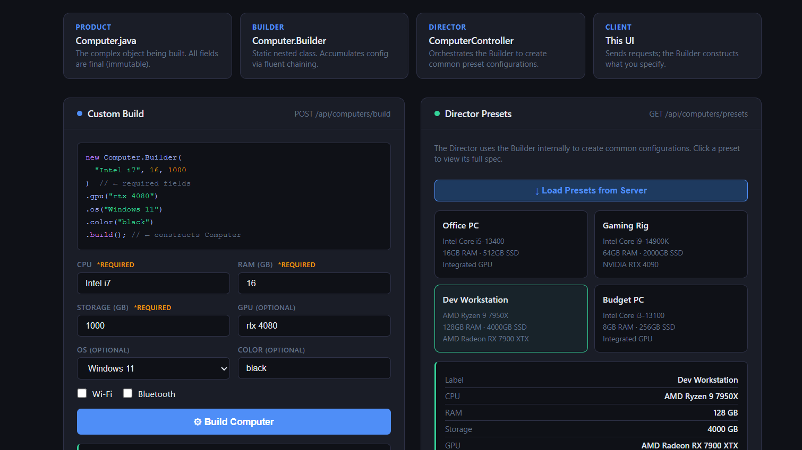

Builder Pattern — How it works here
The 4 roles
RoleClassResponsibilityProductComputer.javaThe complex object. All fields are final — immutable once builtBuilderComputer.BuilderStatic nested class. Collects config via fluent method chainingDirectorComputerControllerOrchestrates the Builder to produce named preset configsClientindex.html (you)Calls the API; the Builder constructs exactly what's requested
Key Builder Pattern code in Computer.java
java// Only REQUIRED fields go in the constructor
Computer pc = new Computer.Builder("Intel i9", 64, 2000)
.gpu("RTX 4090")       // optional — chained
.wifi(true)
.os("Windows 11")
.build();              // ← constructs the final immutable object
Why Builder over constructors?
Without it you'd need a 8-argument constructor: new Computer("i9", 64, 2000, "RTX4090", true, true, "Win11", "Black") — impossible to read, easy to swap args accidentally.

Run it
bashcd builder-demo
mvn spring-boot:run
Then open http://localhost:8080 in your browser.

